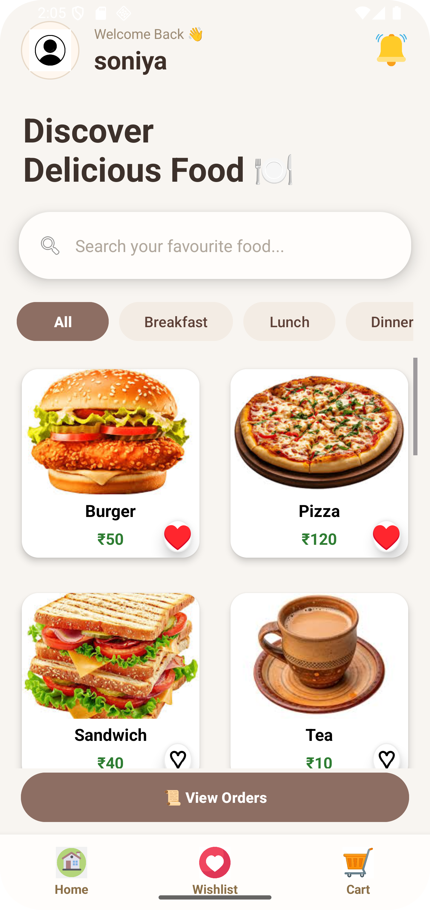
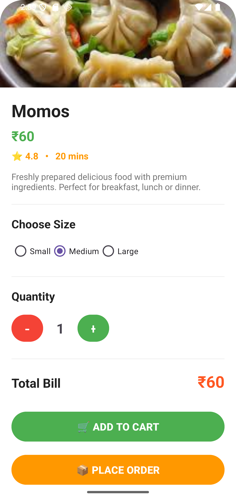
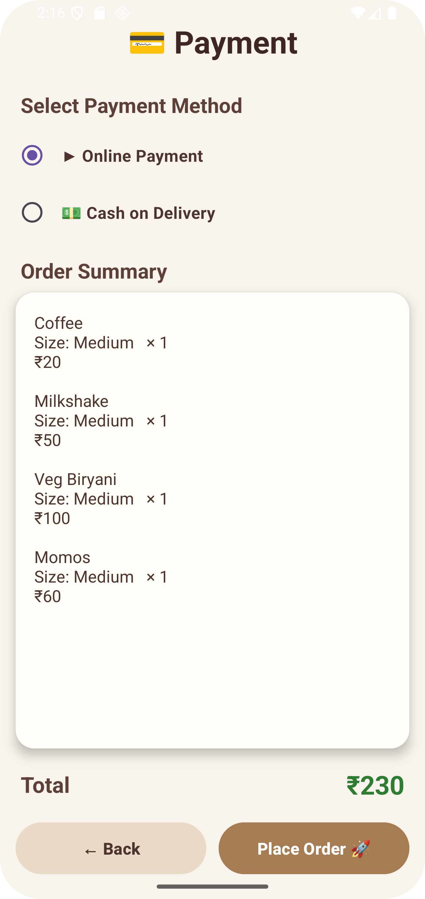

# 🍽️ Canteen Management System

An Android-based Canteen Management System developed using Java, XML, and SQLite.

## 📌 About the Project

The Canteen Management System is designed to help manage canteen operations through an Android application.

## ✨ Technologies Used

- Java
- XML
- SQLite
- Android Studio
- Gradle

## 🚀 Features

- Android-based user interface
- Canteen management functionality
- Data storage using SQLite

## 🛠️ Development Tool

Android Studio

## ScreenShots
## 📱 Application Screenshots

## 📱 Application Screenshots

### 🏠 Home Screen

### 🍽️ Food Details

### ❤️ Wishlist

### 💳 Payment Screen

## 👩‍💻 Developer

**Soniya Mali**

GitHub: [soniya-mali](https://github.com/soniya-mali)

---

*This project was developed for learning and academic purposes.*
