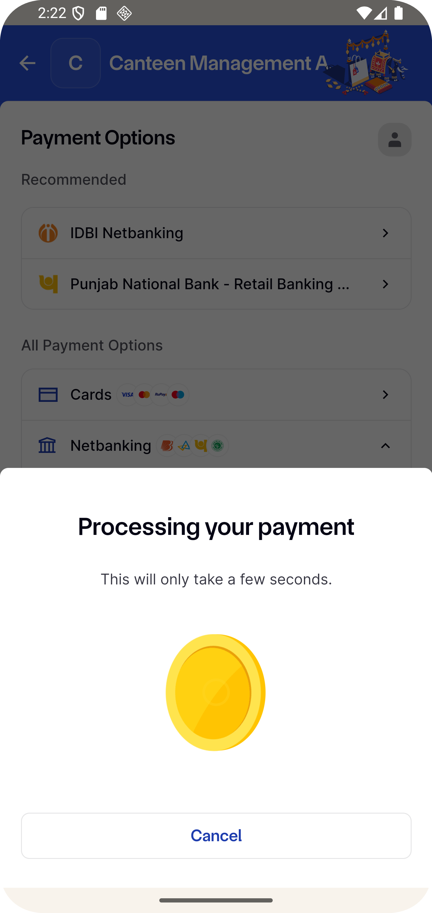

# 🍽️ Canteen Management System

An Android application developed to simplify food ordering and canteen management. Users can browse food items, view food details, manage their wishlist, place orders, make online payments, and track their order history through a user-friendly interface.

## 📱 Features

- 🏠 Home Screen with Food Menu
- 🍔 Browse Food Items
- 🔍 View Food Details
- ❤️ Add Items to Wishlist
- 💳 Payment and Order Summary
- 💰 Razorpay Payment Gateway Integration
- ✅ Payment Success and Failure Handling
- 📦 My Orders and Order History
- 📱 Clean and User-Friendly Interface

## 🛠️ Technologies Used

- **Programming Language:** Java
- **UI Design:** XML
- **Database:** SQLite
- **Payment Gateway:** Razorpay
- **IDE:** Android Studio
- **Build Tool:** Gradle

## 📂 Project Structure

```text
Canteen-Management-System/
│── app/
│── gradle/
│── build.gradle
│── settings.gradle
│── README.md
```

## 🏗️ System Architecture

The application provides a user interface for browsing food items, managing the wishlist, processing payments, and viewing order history.

## 🚀 Getting Started

### Prerequisites

- Android Studio
- JDK compatible with the project
- Android SDK
- Android Emulator or Android Device

### Installation

1. Clone the repository:

   ```bash
   git clone https://github.com/soniya-mali/Canteen-Management-System.git
   ```

2. Open the project in Android Studio.
3. Sync the Gradle files.
4. Run the application on an emulator or Android device.

## 💳 Payment Integration

The application includes a payment flow with payment success and failure screens. Razorpay integration can be used for online payments, depending on the configured implementation.

## 📷 Application Screenshots

### 🏠 Home Screen


### 🍽️ Food Details


### ❤️ Wishlist


### 💳 Payment Screen


### 🏦 Razorpay Payment Gateway


### ✅ Payment Success


### ❌ Payment Failure


### 📦 My Orders


## 👩‍💻 Developer

**Soniya Mali**

GitHub: [soniya-mali](https://github.com/soniya-mali)

## 📄 License

This project is developed for educational and learning purposes.
